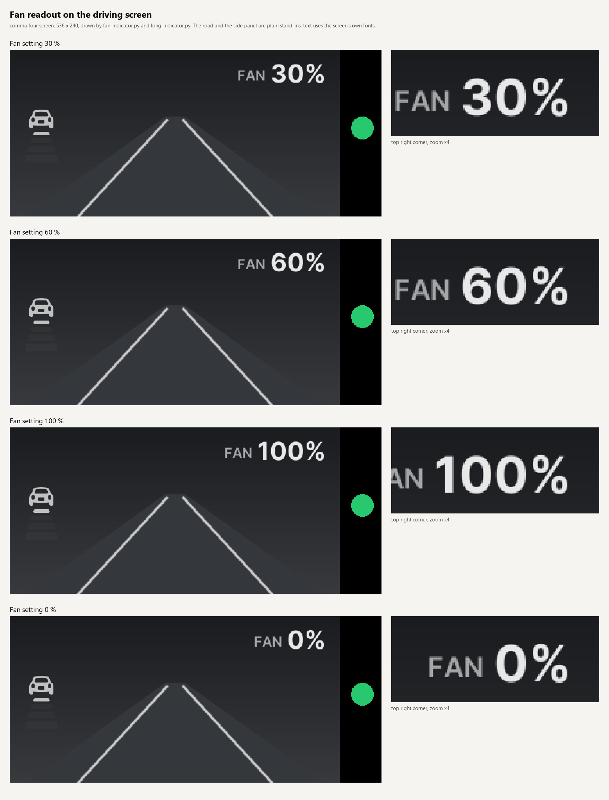
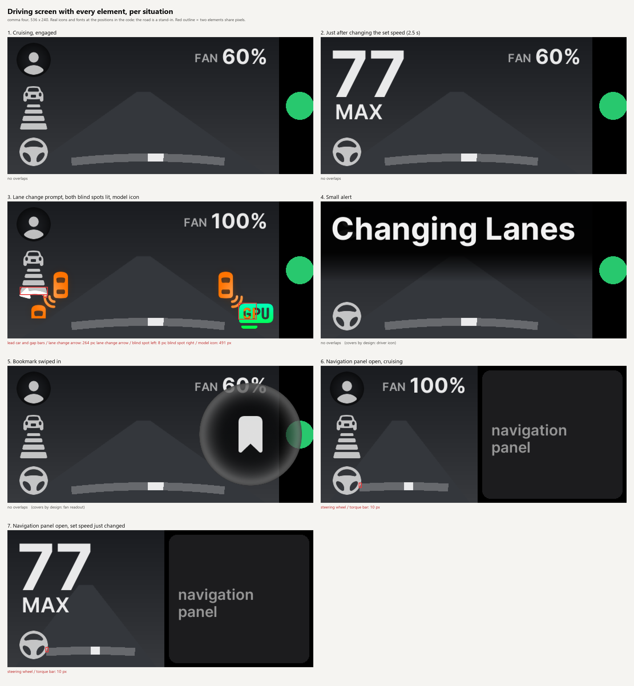

# G70 2024: following distance verified per step, fan readout, screen overlap check, logs read on the PC

Covers 2026-11-19 about 22:00 to 2026-11-20 about 08:00 local time (US Eastern). Drives `000000dc` (2026-11-19 22:35), `000000dd` and `000000de` (2026-11-20 06:13 and 06:26). Continues [2026-11-19-g70-openpilot-longitudinal-cruise-fault-gap-ui.md](2026-11-19-g70-openpilot-longitudinal-cruise-fault-gap-ui.md). Device identifiers and GPS are kept out of this repo.

Statements are marked as observations (measured from logs or tests), inferences, or plans.

## 1. Summary

- **Observation:** every change to gap setting 1 that has been driven shortened the following distance by the amount the setting predicts, within about a metre. At 0.75 s the car follows 34.5 m behind the lead at 75 mph (1.04 s).
- **Observation:** measured against the car's own cruise on its closest setting, openpilot at 0.75 s is 2 m closer at 70–75 mph, 6 m closer at 75–80 mph and 1 m further at 60–65 mph.
- **Observation:** at 0.75 s the gap stayed between 0.86 s (1st percentile) and 1.05 s (median) and never went under 0.6 s; one slowdown used −3.0 m/s² of the −3.5 m/s² available.
- **Observation:** the set speed now matches the cluster (cluster 77.0 mph at a set speed of 77.5; before, 1.45 mph over), and acceleration swings with a lead are at the stock level (1.7 per minute against 1.8).
- **Observation:** highway steering is better than on the previous drives and not yet at the best (`d4`). The first real low-speed data (141 s at 20–45 mph, night) shows 13 ping-pong swings per minute.
- **State:** `g70-fingerprint` @ `657c56a`; gap setting 1 at 0.69 s; friction ramp 0.24 below 13 m/s rising to 0.40 at 18 m/s; fan readout on the comma screen. The last two device changes are not driven.
- **Tooling:** drive logs can now be read on the PC (`pclog.py`), so most analysis no longer needs the comma.

## 2. Following distance (observations)

Steady following: openpilot longitudinal active, no gas, lead present, above 45 mph, closing speed within 1 m/s, |acceleration| under 0.3 m/s², held 3 s. All steady following in these drives was on gap setting 1 (`gap_check.py`). Expected distance = following time × speed + 6 m + extra lead distance.

| Drives | Setting 1 | Steady (min) | Speed (mph) | Distance p10 / median / p90 (m) | Expected (m) | Time gap (s) | Following time implied (s) |
|---|---|---|---|---|---|---|---|
| `d5` | 1.25 s, no extra | 1.7 | 61 | 36.2 / 40.1 / 50.1 | 40.4 | 1.47 | 1.25 |
| `d6` | 1.05 s, +2 m | 2.1 | 74 | 34.8 / 42.0 / 44.5 | 42.5 | 1.31 | 1.05 |
| `da`, `db` | 0.99 s, +2 m | 3.6 | 68 | 35.3 / 38.9 / 44.8 | 38.3 | 1.29 | 1.02 |
| `dc`–`de` | 0.75 s, +2 m | 4.8 | 75 | 31.7 / 34.5 / 43.7 | 33.3 | 1.04 | 0.80 |

- The plan was never held by the model's own acceleration during steady following (0 % in every group), so the setting is what decides the distance there.
- 0.93 s was installed for a few hours and never driven. 0.69 s (set 2026-11-20) is not driven; it works out to 29.6 m at 70 mph (0.95 s).

### Against speed, with the car's own cruise (`gap_speed.py`)

Median distance in metres per 5 mph band, bands with at least 8 s of steady following (here from 20 mph, held 2 s).

| Setup | 45–50 | 50–55 | 55–60 | 60–65 | 65–70 | 70–75 | 75–80 | Steady (min) |
|---|---|---|---|---|---|---|---|---|
| Stock cruise, closest setting (12 drives) | 24.4 | 29.0 | | 30.9 | 32.7 | 35.1 | 42.6 | 22.1 |
| openpilot 1.25 s | | | 39.0 | 39.6 | 46.2 | 48.9 | | 2.0 |
| openpilot 1.05 s + 2 m | | | | 42.0 | 40.6 | 42.3 | 42.4 | 2.7 |
| openpilot 0.99 s + 2 m | | | 36.9 | 36.3 | 39.4 | 42.0 | | 3.7 |
| openpilot 0.75 s + 2 m | | | | 32.2 | 30.6 | 32.8 | 36.4 | 5.2 |
| openpilot 0.69 s + 2 m (expected, not driven) | | | | 27.3 | 28.8 | 30.4 | 31.9 | |

- The openpilot groups have 9–170 s per band; treat single bands as indications.
- No openpilot setting has steady-following data below 55 mph.

### Slowdowns at each setting (`gap_safety.py`; following above 34 mph)

| Setting 1 | Following (min) | Time gap p1 / p5 / median (s) | Under 0.8 s | Under 0.6 s | Shortest time to collision (s) | Strongest braking command (m/s²) |
|---|---|---|---|---|---|---|
| 1.05 s (`d6`) | 10.1 | 0.77 / 1.21 / 1.35 | 1.2 % | 0.36 % | 4.5 | −1.95 |
| 0.99 s (`da`, `db`) | 9.1 | 0.48 / 0.81 / 1.31 | 4.6 % | 2.24 % | 3.8 | −1.85 |
| 0.75 s (`dc`–`de`) | 10.5 | 0.86 / 0.96 / 1.05 | 0.8 % | 0.00 % | 5.7 | −2.99 |

- **Observation:** the short gaps in the earlier groups are cut-ins and lane changes, not the setting: at 0.75 s the low end of the distribution is higher than at 0.99 s.
- **Observation:** the one event below −1.5 m/s² at 0.75 s: 75 → 67 mph over 1.9 s behind a lead closing at 9 mph, smallest gap 0.65 s / 20 m, command −2.99 m/s². The panda's limit is −3.5 m/s².
- **Inference:** at 0.69 s the same event leaves less margin to that limit.

## 3. Other speed-control checks on `dc`–`de` (observations)

- **Set speed:** holding speed with no lead for 72 s, cluster 77.0 mph and set 77.5 mph, cluster minus set +0.32 mph (`da`, `db`: +1.45 mph). The cluster-speed scaling works.
- **Speed see-saw with a lead:** 1.7 acceleration swings of 0.4 m/s² or more per minute (stock 1.8; `d5` 8.7, `d6` 6.0, `da` / `db` 3.4). Without a lead: 7.0 per minute on 2 minutes.
- **Stops:** one, without a lead. The earlier stop request (`g70_long_stop_speed`) has not met a stop behind a car.
- No stock FCW, automatic braking or planner FCW; no cruise fault; no tracebacks.

## 4. Steering (observations, `sway.py`)

Settings as on `d4` and `d6`: controller delay 0.20 s, friction ramp flat 0.40.

| Above 60 mph, hands off | `d4` (daylight, best) | `d6` | `da`, `db` (delay 0.15) | `dd`, `de` |
|---|---|---|---|---|
| Lane movement 0.2–0.7 Hz, all stretches (cm) | 2.44 | 3.91 | 3.90 | 2.98 |
| Ping-pong per minute, straights | 3.5 | 3.8 | 3.6 | 3.0 |
| Swings of 15 cm or more per minute | 0.47 | 0.58 | 1.29 | 0.55 |
| Wobble per minute | 2.0 | 3.1 | 4.3 | 8.4 |

- **Driver:** hunting better than last time, still more than the best.
- Same road as the 0.15 s drives (4.8 min): ping-pong 3.6 against 2.4, wobble 9.9 against 4.1. The wobble count depends on the road (earlier findings) and these shared stretches are short.
- **Low speed, 20–45 mph, `dc` (night, 141 s hands off):** 13.2 ping-pong swings per minute, 8.1 of 15 cm or more, lane movement 5.2 cm at 0.2–0.7 Hz. `d4` on 204 s: 5.0, 1.8 and 3.3 cm.
- **Plan / state:** friction ramp `0.24 0.40 13 18` (0.24 below 29 mph, 0.40 from 40 mph). The earlier speed-dependent ramp blended at 45–56 mph and made 45–60 mph worse; this one leaves everything above 40 mph at 0.40. Not driven.
- **Inference (not tested):** part of the night-drive movement may be lane lines seen less steadily in the dark.

## 5. Fan readout and the screen overlap check

- **`bb1c191`:** `fan_indicator.py` draws `FAN nn%` (`deviceState.fanSpeedPercentDesired`, the commanded setting) in the top right of the camera view when `/data/g70_ui_fan` exists; hidden under alerts, and for the 2.5 s of the set-speed display when the view is narrower than 400 px (navigation panel open). **Driver: worked well.**

- **Overlap check (`render_screen_map.py`):** every element of the driving screen placed from the real icons and fonts at the positions in the code, in seven situations, with a pixel test.

| Overlap | Pixels | Origin |
|---|---|---|
| Fan readout with anything (other than under the bookmark circle, by design) | 0 | |
| Four gap bars and the lane-change arrow | 264 | `9aa2965` (stock three bars: 59) |
| Right blind-spot icon and the model status icon | 491 | stock |
| Steering wheel and torque bar, navigation panel open | 10 | stock |
| Lane-change arrow and left blind-spot icon | 8 | stock |

- The four-bar layout ends 4.5 px lower than stock and reaches further into the lane-change arrow. The earlier statement that the bars cleared what is below them had checked the steering wheel only. A 3 px gap layout that ends where stock does is prepared in the analysis, not built; the driver chose to leave the bars.
- This render places elements by hand from the code's numbers; it does not run the widgets. The camera image, path and lead marker are not drawn.

## 6. System load and temperature (observations)

`deviceState` is logged at 2 Hz. Read for `db` and, by scanning the low-rate logs of all 60 drives then on the device, for the hottest one.

| Run | What | Peak temperature | Intake air | Fan | Processor load |
|---|---|---|---|---|---|
| `db` (10.8 min drive) | warm-up from 37 °C | 68.6 °C, still rising | | 30 % throughout | 55 % mean, busiest core 91 % |
| `b3` (2026-11-15, 27.7 min, car stationary) | hottest on the device | 76.5 °C | 37 → 56 °C | 30 % → 60 % at minute 6, then to 67 % | 50 % mean, busiest core 85 % |
| `d2` (hottest moving drive) | | 73.5 °C | | 60 % | 53 % mean |

- Thermal status `ok` on every run. Most drives peak near 73 °C.
- **Inference:** the hottest run was hot because of cabin air, not load: load was normal and intake air was 19 °C higher than at the start of `db`.
- GPU load reads 0 % throughout; taken as not reported on this device. Free storage 10 %.

## 7. Reading logs on the PC

- `tools/drive-eval/pclog.py`: `pip install pycapnp zstandard`, then `for msg in pclog.read(path)`. It loads `log.capnp` from the sunnypilot checkout's `cereal` folder (`CEREAL_DIR`) and `car.capnp` from a copy taken with `git show HEAD:opendbc_repo/opendbc/car/car.capnp` (`CAR_CAPNP_DIR`).
- A 60 s segment (109,000 messages) reads in about 0.3 s. A segment cut off mid-message at ignition-off is read up to the cut.
- The extract scripts for `sway.py` and `long_baseline.py` still run on the comma; `gap_check.py`, `gap_safety.py` and anything new can use the PC reader.
- The comma had a wifi address on the PC's network but did not accept connections from it (no reply to SSH, not found in a scan by its host key); USB remains the route.

## 8. Device record (user-authorized, local time)

| When | Change |
|---|---|
| 2026-11-19 about 22:25 | `bb1c191` installed; `/data/g70_ui_fan` created; reboot |
| 2026-11-20 about 07:25 | `657c56a` installed (following-time floor 0.6 s); `/data/g70_long_follow` = `0.69 1.25 1.45 1.75`; reboot |
| 2026-11-20 about 07:35 | `/data/g70_friction_threshold` `0.40` → `0.24 0.40 13 18` |

Current: `g70-fingerprint` @ `657c56a`, rollback branch `g70-fingerprint-prev` = `bb1c191`.

## 9. Open

- Drive the 0.69 s setting and the low-speed friction ramp; a few minutes hands off at 25–45 mph in daylight.
- A stop behind a car with the earlier stop request.
- Whether the cluster shows an AEB or collision-system warning with openpilot longitudinal (asked four times, not answered).
- Four bars against the lane-change arrow; the settings menu with three names; 0x7D0 rejected once a second; `cruiseMismatch`; LKAS11 chime filter untested; `adb` not installed permanently.
