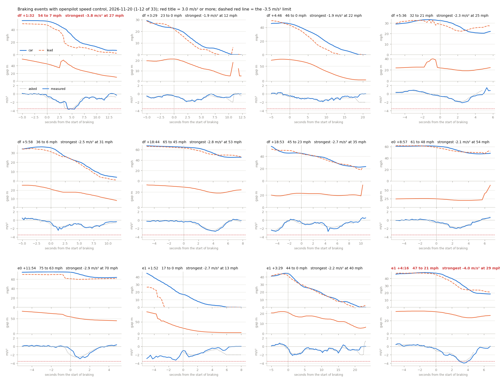
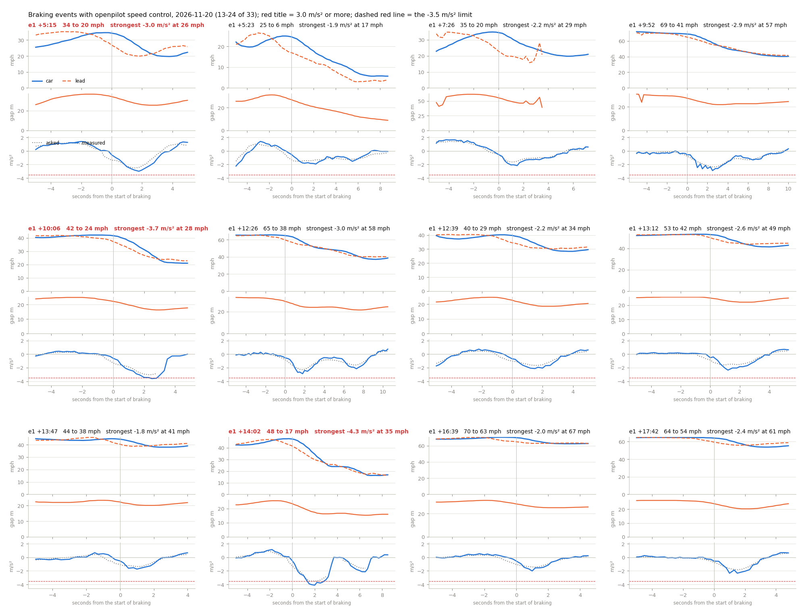
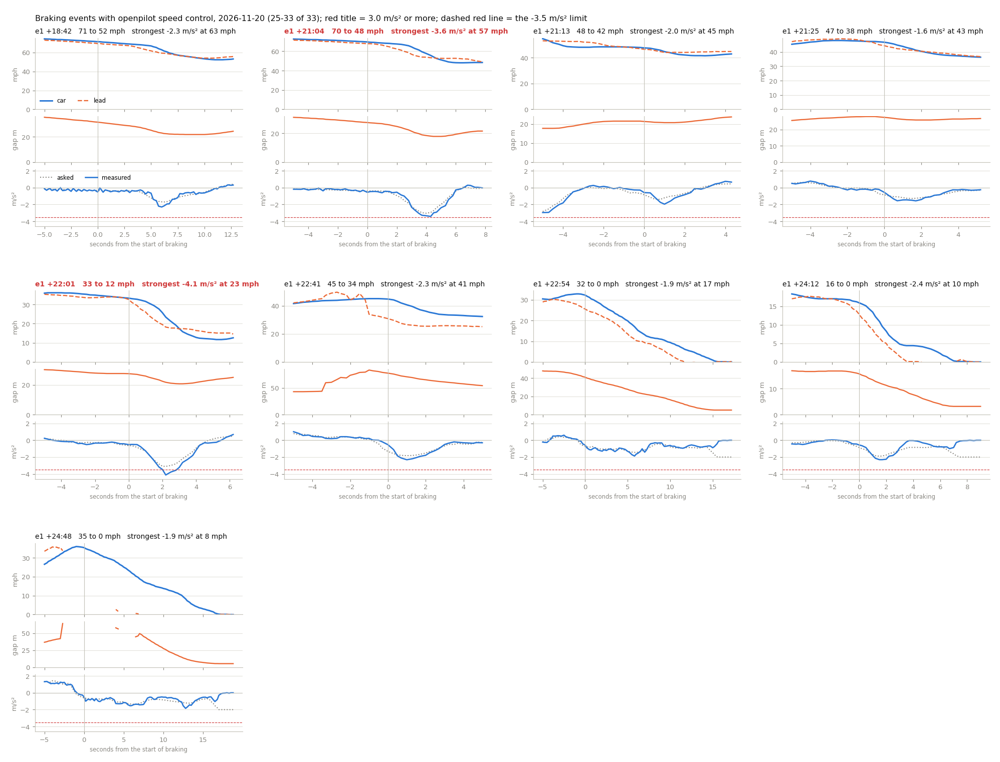

# G70 2024: hard braking behind a slowing lead at the 0.69 s gap

Covers 2026-11-20 about 17:30 to 18:30 local time (US Eastern). Uses drives `000000df`, `000000e0` and `000000e1` (all at the 0.69 s gap setting). Continues [2026-11-20-g70-restart-delay-stops-low-speed-steering.md](2026-11-20-g70-restart-delay-stops-low-speed-steering.md). Device identifiers and GPS are kept out of this repo.

Statements are marked as observations (measured from logs or replays), inferences, or plans.

## 1. Summary

- **Driver:** the firm braking is not only near stops; it also happens at higher speed.
- **Observation:** 33 substantial braking events on the three drives; seven reached 3.0 m/s² or more, at up to 70 mph. Measured deceleration went past the −3.5 m/s² command limit (to −4.3).
- **Observation:** the car starts braking a median 1.3 s after the lead starts slowing, and brakes harder than the lead did in 20 of 29 events from 25 mph or more.
- **Observation:** three changes to the planner's timing were replayed through the real planner and none moves the start of braking (median 0.00 s). The one that had been recommended and built was not installed.
- **Observation:** below about 55 mph the driving model's own request starts the braking; the strongest braking always comes from the lead plan, which asks for far more than the model does at that moment.
- **Inference:** the hard part is the lead plan restoring the gap the setting demands. The lever is the following time.
- **Device:** `/data/g70_long_follow` `0.69 …` → `0.85 1.25 1.45 1.75` (about 35 m at 70 mph instead of 30). Not driven.

## 2. The events (observations, `brake_events.py`, `brake_plot.py`)

An event is a measured deceleration of 1.5 m/s² or more held 0.5 s, or a slowdown to a standstill from above 15 mph, with openpilot longitudinal active. Each panel: speed of the car and the lead, gap, and acceleration asked and measured; time zero is where braking begins.

| Drive, time in | Speed (mph) | Strongest measured (m/s²) | Lead's strongest over 1 s (m/s²) | Time gap at the start (s) |
|---|---|---|---|---|
| `e1` +14:02 | 48 → 17 | −4.3 | −2.9 | 1.11 |
| `e1` +22:01 | 33 → 12 | −4.1 | −3.2 | 1.85 |
| `e1` +4:16 | 47 → 21 | −4.0 | −3.5 | 1.59 |
| `df` +1:32 | 54 → 7 | −3.8 | stronger (sharp stop ahead) | 1.85 |
| `e1` +10:06 | 42 → 24 | −3.7 | −2.6 | 1.19 |
| `e1` +21:04 | 70 → 48 | −3.6 | −2.7 | 0.88 |
| `e1` +5:15 | 34 → 20 | −3.0 | −2.7 | 2.24 |

Over the 29 events that began at 25 mph or more:

- The lead began slowing a median 1.3 s before the car's braking began (lead slope under −0.7 m/s² over 1 s; a rough measure).
- Car's strongest deceleration median −2.36 m/s², lead's −1.97; the car was more than 0.3 m/s² harder than the lead in 20.
- Time gap at the start of braking: median 1.19 s; 0.84–0.99 s on the highway events. Closing speed at the start: median 4 mph.
- Asked and measured acceleration track each other within about 0.5 s, so the lateness is in the plan.

### One event in detail (`e1` +14:02)

- −3.5 s: the lead, which had been accelerating, starts to slow from 47.3 mph. The car is still accelerating at +1.0 m/s² to close a 25.6 m gap.
- −3.0 s: radard's lead acceleration reads −0.48; its fade constant is still the stock 1.5.
- −2.3 s: the plan first goes negative. −2.0 s: plan −0.96. −1.5 s: plan −1.71, the car −1.61.
- 0 s: plan at the −3.5 limit, the car at −4.29, the lead at −2.7; gap 17.6 m.
- +1.7 s: the car is at 23.8 mph, below the lead's 25.9, and the plan lets go.

## 3. What was tried in replay (observations)

`replay_lead_brake.py` and `replay_plan_variants.py` run the installed `LongitudinalPlanner` on the parked comma over all of `e1`, several variants side by side. The unchanged replay matches the logged request (correlation 0.999, rms difference 0.03 m/s²). The car's response and the gap are the logged ones.

| Variant | Request passes −0.5 m/s² earlier by (median, 20 events) | Best cases | Strongest request (median) | Swings ≥ 0.4 m/s² per min while following |
|---|---|---|---|---|
| Unchanged | | | −1.79 | 7.2 |
| Lead keeps braking: fade constant at most 0.3 when the lead decelerates over 0.2 m/s² | 0.00 s | 0.05–0.20 s | unchanged | 7.5 |
| Same, fade constant 0 | 0.00 s | 0.25–0.50 s on highway events | −1.94 on its event set | 8.3 |
| Smoothness weights × 0.4 | 0.00 s | 0.15–0.35 s on highway events | −1.92 | 7.6 |
| Plan read 0.3 s further ahead | 0.00 s | 0.05–0.10 s | −1.78 | 7.3 |
| Both of the last two | 0.00 s | 0.25–0.35 s | −1.92 | 7.6 |

- The first variant had been recommended as the most promising and was written for the branch (`g70_long.lead_brake_tau`, `/data/g70_long_lead_brake`). It was not committed or installed.
- **Why the fade constant matters little:** radard already drives it to near zero within about 0.6 s once the lead's deceleration passes 0.5 m/s².

## 4. Which part of the planner brakes (observations, `plan_source.py`, `e1`)

The planner takes the lowest of three requests: the lead plan, the cruise plan and the driving model's own acceleration. Experimental mode is off; this branch includes the model's request anyway.

| | Lead plan | Model | Cruise |
|---|---|---|---|
| All active time (22.2 min) | 69 % | 26 % | 4 % |
| Request below −0.5 m/s² (3.2 min) | 75 % | 25 % | 0 % |
| Request below −1.5 m/s² (0.6 min) | 90 % | 10 % | |

- Of 38 braking stretches, the model was the first to pass −0.5 m/s² in 23 (all below about 55 mph) and the lead plan in 14 (all nine above 55 mph).
- The strongest request came from the lead plan in 30. In the events at −3.0 or stronger the lead plan asked −3.0 to −3.5 while the model at the same moment asked −1.05 to −2.2.
- **Inference:** the model starts the braking in town and the planner tweaks do not touch it; the lead plan then brakes hard because the gap is under time × speed + 6 m + extra and it restores it at once. With more following time there is more room before that point.

## 5. Device record (user-authorized, local time)

| When | Change |
|---|---|
| 2026-11-20 about 18:20 | `/data/g70_long_follow` `0.69 1.25 1.45 1.75` → `0.85 1.25 1.45 1.75`; no reboot (read at the next ignition) |

Current: `g70-fingerprint` @ `e3f7ac8`, unchanged.

- The onroad processes (plannerd, controlsd, modeld) are not running while parked, so a file they read needs no reboot; a file read by an always-running process (the screen) does.

## 6. Open

- Drive 0.85 s and rerun `brake_events.py` / `brake_plot.py` for a like-for-like comparison. A replay cannot answer it: the gap in a replay is the logged one.
- Measured deceleration beyond the −3.5 m/s² request (to −4.3): not examined.
- Whether to leave the model's request in the planner's choice with experimental mode off.
- Still not driven: two-stage restart, 0.6 m/s stop speed, low-speed steering look-ahead.
