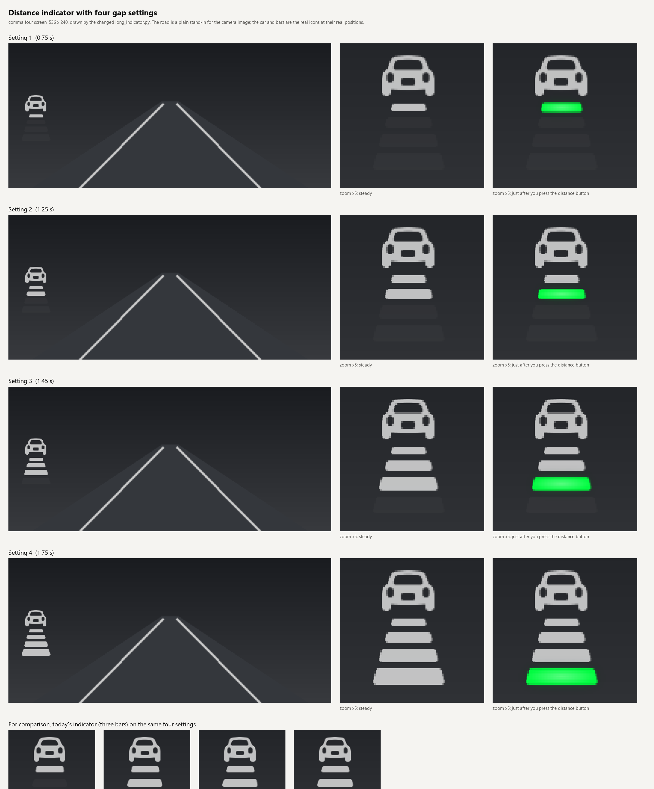

# G70 2024: openpilot longitudinal settled in — cruise fault from the main button, panda rule, close stops, cluster speed, four gap bars

Covers 2026-11-19 23:50Z to about 2026-11-20 03:00Z. Drives `000000d6`–`000000db`. Continues [2026-11-19-g70-friction-ramp-openpilot-longitudinal.md](2026-11-19-g70-friction-ramp-openpilot-longitudinal.md). Device identifiers and GPS are kept out of this repo.

Statements are marked as observations (measured from logs or tests), inferences, or plans. The device clock was unset after several reboots in this period, so later times are approximate.

## 1. Summary

- **Observation:** engaging openpilot longitudinal from the main cruise button (`06a4aa0`) raised "Cruise Fault: Restart the Car" 1.4 s after the press. The panda allows longitudinal controls only after a set or resume press, so it rejected openpilot's SCC12 while SCC11 and SCC14 said cruise was active, and the ESC faulted. **This was caused by a change made in this project and missed in its testing.**
- **Observation:** with a panda rule that also enters controls when the main button turns main cruise on (`9d84a23`, firmware `c9c5f7f0…`), the main button engaged four times on `da` and `db` with no fault.
- **Observation:** the panda safety tests can be built and run on the comma. Full suite: 9232 tests pass, including 7 new ones. They also showed 9 failures that the earlier TX-list changes had left in the test bookkeeping; fixed.
- **Observation:** two stops ended 0.8 m (`d5`) and 0.7 m (`db`) behind the lead, the second with 2 m of extra lead distance. Below about 2 mph the car rolled for about 5 s against a request of −0.2 to −0.4 m/s² until the planner asked for a stop at 0.3 m/s. The planner now asks at 1.0 m/s while its lead / cruise plan is braking; in a replay of `db` it asks with 4.5 m to go where it asked with 1.0 m.
- **Observation:** the cluster reads 1.9 % above the wheel-speed value openpilot controls (78.0 against 76.6 mph, every steady sample on `da` and `db`). The planner now scales its cruise target by the measured ratio.
- **Observation:** the planner's following time is not the gap: it adds a fixed 6 m (plus the extra lead distance). 1.05 s with 2 m extra measured 1.31 s at 72 mph.
- **Observation:** a steering controller delay of 0.15 s showed no gain over 0.20 s on 10.7 shared minutes. Back to 0.20 s.
- **State:** `g70-fingerprint` @ `5ad67b7`. Not driven: gap setting 1 at 0.75 s, cluster-speed scaling, the earlier stop request, the four-bar indicator on the comma screen, and the gap-reader fix.

## 2. Drives (observations)

| Drive | Build | What was new | Result |
|---|---|---|---|
| `d6` | `87e6a9e` | flat 0.40 ramp, extra lead distance 2 m, either-toggle engage, four gap settings (1.05 / 1.25 / 1.45 / 1.75 s) | Engaged from the accelerate toggle three times; gap button cycled four settings; one stop 3.2 m behind the lead, restart by itself after 1.9 s; 6.0 acceleration swings per minute with a lead. **Driver: hunting improved.** |
| `d7`, `d8`, `d9` | `06a4aa0` | main-button engage, lead-departure bit cleared, setting 1 at 0.99 s, steering delay 0.15 s | Cruise fault on the first main-button press (`d7`, 20 mph); `accFaulted` latched through `d8` and `d9` without a press. No engaged driving. |
| `da`, `db` | `de7b8cf` | panda rule for the main button | Main button engaged four times, no fault, `controlsAllowed` on every sample while active; lead-departure bit set by the camera on 41 frames, 0 sent; 3.4 acceleration swings per minute with a lead; one stop 0.7 m behind the lead. **Driver: wandering a little better, not as good as the best; set 78 shows 79–80.** |

Steering above 60 mph (`sway.py`, hands off, straights):

| Drives | Controller delay | Straights (min) | Ping-pong /min | Swings ≥ 15 cm /min | Wobble /min | Wheel reversals /min |
|---|---|---|---|---|---|---|
| `d4` (stock longitudinal, daylight) | 0.20 | 4.2 | 3.5 | 0.47 | 2.0 | 23 |
| `d6` | 0.20 | 6.8 | 3.8 | 0.58 | 3.1 | 26 |
| `da`, `db` | 0.15 | 7.0 | 3.6 | 1.29 | 4.3 | 32 |

Same road, `da` / `db` against `d6` (10.7 min): ping-pong 3.6 against 3.1 per minute, wobble 4.3 against 3.5, lane 0.2–0.7 Hz 4.71 against 4.29 cm.

- **Observation:** lane-offset movement at 0.2–0.7 Hz over all hands-off time above 60 mph is 3.9 cm on `d6`, `da` and `db` and 2.4 cm on `d4` and `c4`. `d4` was driven in daylight; `d5` onward were after dark.
- **Inference (not tested):** part of the difference may be lane lines seen less steadily at night; a daylight drive on the current setup would separate that from the tune and from openpilot longitudinal.

## 3. The cruise fault (observations, `d7`)

| Time after the press | Event |
|---|---|
| 0.00 s | main button pressed at 20 mph; SCC11 `MainMode_ACC` 0 → 1 |
| 0.06 s | released; openpilot enabled (state `overriding`, gas pressed), SCC12 `ACCMode` 2, set speed 25 mph; TCS13 `ACC_REQ` 1 |
| 0.9 s | gas released; `longActive`, SCC12 `ACCMode` 1 with +0.4 m/s² |
| 0.9–1.4 s | panda `controlsAllowed` false throughout; SCC12 rejected (25 frames, `src` 192), `safetyTxBlocked` rising by 5 per 0.1 s |
| 1.4 s | TCS13 `ACCEnable` 0 → 3, `ACC_REQ` 0; `accFaulted`, "TAKE CONTROL IMMEDIATELY / Cruise Fault: Restart the Car" |

- The panda's `hyundai_common_cruise_buttons_check` set `controls_allowed` on the falling edge of set or resume only; the main button toggled `acc_main_on` and nothing else.
- The device-side test of `06a4aa0` exercised `CarState.update_button_enable` (nine cases) and did not include the panda.
- `ACCEnable` stayed non-zero from the first seconds of `d8` and `d9`; it cleared after the car was restarted (`da` starts clean).

## 4. Panda change and safety tests

`9d84a23` (`opendbc/safety/modes/hyundai_common.h`), with a toggleable main cruise and openpilot longitudinal:

- the falling edge of the main button enters controls if that press turned main cruise on;
- a press that turns main cruise off exits controls (before: only cancel did).

Firmware: sha256 `c9c5f7f0…`, signature `b2c5c4b3758b072d`.

Running the safety tests on the comma (parked), outside the installed tree:

```
cp -r /data/openpilot/opendbc_repo/opendbc /data/tmp/st/opendbc        # then overlay the changed files (LF)
cd /data/tmp/st/opendbc/safety/tests/libsafety
gcc -shared -fPIC -Wall -Wextra -Werror -nostdlib -fno-builtin -std=gnu11 -Wfatal-errors -Wno-pointer-to-int-cast \
    -DALLOW_DEBUG -I/data/tmp/st -o libsafety.so safety.c
cd /data/tmp/st && PYTHONPATH=/data/tmp/st /usr/local/venv/bin/python -m unittest opendbc.safety.tests.test_hyundai
```

| Run | Result |
|---|---|
| Installed source (`06a4aa0`), Hyundai tests | 1899 run, **9 failures**, all `test_tx_hook_on_wrong_safety_mode`: 0x420 and 0x484 are in more than one Hyundai TX list since `5aeff4e` and `cca8ce7`, and the cross-mode check had no exception for them |
| With the exceptions added to `tests/common.py` and the new rule | Hyundai 1906 OK; Hyundai CAN FD 2487 OK; all 25 test files 9232 OK (967 skipped) |
| New `test_main_cruise_button_enters_controls` | passes in all 7 longitudinal test classes |
| Replay of `d7` through the new rule (`tools/drive-eval/replay_fault.py`) | `controls_allowed` true at the button release; 25 of 25 rejected SCC12 frames accepted |

- **Observation:** the panda also rejects 0x7D0 (tester present, 1 Hz) in camera-SCC longitudinal mode: 60 per minute since `d5`. It is not in that TX list and nothing depends on it there. Not changed.

## 5. openpilot longitudinal settings added (all in `g70_long.py` unless noted)

| File | Meaning | Commit | Set to |
|---|---|---|---|
| `/data/g70_long_follow` | following time per gap setting; floor lowered 1.0 → 0.9 → 0.7 s | `06a4aa0`, `b451982` | `0.75 1.25 1.45 1.75` |
| `/data/g70_long_engage_main` | main button engages at the current speed above 2.2 m/s (`carstate.py`; needs the panda rule) | `06a4aa0`, `9d84a23` | present |
| `/data/g70_long_no_lead_alert` | clears LKAS12 bit 32 in the re-sent message (`hyundaican.py`, `carcontroller.py`) | `06a4aa0` | present |
| `/data/g70_long_cluster_speed` | cruise target × measured true / cluster ratio, learned above 10 m/s at \|a\| < 0.3 m/s², kept in 0.95–1.0 | `671d3db`, `cdc921c` | present |
| `/data/g70_long_stop_speed` | the lead / cruise plan asks for a stop below this speed while it is braking (target < −0.05 m/s²); stock 0.3 m/s | `671d3db` | `1.0` |

- **Lead-departure announcement (observation):** LKAS12 byte 4 bit 0 (`CF_Lkas_TsrAddinfo_Display` bit 0) was set for 4.1 s on `d5` and `d6`, both times standing with the lead moving off at 6–7 mph, in 69,150 frames over five drives, and never on three drives with stock longitudinal.
- **Following time against gap (observation):** the solver's desired distance is `t_follow × v + 6 m` at equal speeds, plus the extra lead distance. Measured steady gaps: 1.31 s at 72 mph with 1.05 s and 2 m (`d6`), 1.29 s with 0.99 s (`da`, `db`, settings mixed). 0.75 s with 2 m works out to about 1.0 s at 72 mph and 1.2 s at 40 mph; the car's own closest setting measured 1.11 s.
- **Close stops (observation):** `db` at 476–481 s: 4.5 m at 2.2 mph with a target of −0.71, then 2.0, 1.9, 1.3 mph at 3.3, 2.5, 1.6 m with targets of −0.40 to −0.33, `shouldStop` at 0.6 mph and 1.0 m, standing at 0.7 m. `tools/drive-eval/replay_planner.py` feeds the logged messages to the installed planner: with the 1.0 m/s setting `shouldStop` comes at 2.2 mph and 4.5 m, and the acceleration targets match the logged ones within 0.05 m/s².
- **Cluster speed (observation):** the same replay showed the first version learning from braking (cluster 15 against 12.7 mph true while slowing), which pulled the ratio to 0.963; `cdc921c` learns only at steady speed, and the ratio settles at 0.981.
- **Open:** whether the cluster offset is a ratio or a fixed amount cannot be told from steady data at 72 and 77 mph (both fit); at 30 mph the two differ by about 0.9 mph.

## 6. Gap setting display

- **Cluster (observation, driver):** going from setting 1 to 4 the cluster showed three bars and then the fourth a moment later. `GapReader` re-read the gap file every 0.5 s and fell back to the personality while the two disagreed. `5ad67b7`: period 0.1 s, and an immediate re-read (at most every 0.02 s) on a disagreement. Replay of the sequence: 0.49 s of three bars before, one 10 ms frame after.
- **comma screen (`9aa2965`, `long_indicator.py`):** with four gap settings, the three stock bars at their stock sizes plus a smaller one above (24 × 5, 32 × 7, 40 × 9, 48 × 11 px), 4 px between each pair (stock: 6 px), from y 118 to 162; lit by the gap setting; the change highlight follows the setting. Three settings: unchanged. Rendered before installing by running the widget code with a drawing stand-in (`tools/drive-eval/render_gap_ui.py`):



- The first layout had gaps of 4, 3.5 and 4 px (driver: not equal); the gaps in the render above measure 4, 4 and 4 px.
- Not changed: the comma's settings menu still lists three following-distance names.

## 7. Device record (user-authorized; UTC, times after 01:00 approximate)

| When | Change |
|---|---|
| 2026-11-20 about 00:25 | `06a4aa0` installed; `/data/g70_long_follow` = `0.99 1.25 1.45 1.75`; `g70_long_engage_main`, `g70_long_no_lead_alert` created; `/data/g70_lat_ctrl_delay` 0.20 → 0.15 |
| 00:45 | `g70_long_engage_main` removed after the cruise fault |
| about 00:55 | `de7b8cf` installed, panda reflashed (`c9c5f7f0…`); `g70_long_engage_main` created again |
| after `db` | `671d3db`, `cdc921c` installed; follow `0.93 …`; `g70_long_stop_speed` = `1.0`; `g70_long_cluster_speed` created |
| later | `b451982` installed; follow `0.75 1.25 1.45 1.75`; `/data/g70_lat_ctrl_delay` 0.15 → 0.20 |
| later | `9aa2965` installed (four-bar indicator) |
| later | `5ad67b7` installed (gap reader); verified over the network, the USB link did not return after this reboot |

Current: `g70-fingerprint` @ `5ad67b7`, rollback branch `g70-fingerprint-prev` = `9aa2965`. No tracebacks from controlsd, modeld, lagd, card, pandad, plannerd, radard, selfdrived or the UI on `d6`–`db` or after the last boot.

## 8. Open

- Drive `5ad67b7`: stops (target 3 m or more behind the lead), set speed against the cluster, the 0.75 s setting in sudden slowdowns, the four bars on the comma screen and on the cluster.
- Whether the cluster shows an AEB or collision-system warning with openpilot longitudinal (asked three times, not answered).
- Steering: daylight drive on the current setup; low-speed hunt (20–45 mph) still without data.
- Speed see-saw with a lead (3.4 per minute on `da` / `db`, stock 1.8).
- 0x7D0 rejected by the panda once a second; `cruiseMismatch` while engaged; LKAS11 chime filter untested; settings menu with three names; `adb` not installed permanently.
